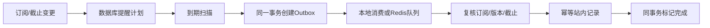

# 基础工程架构与当前边界

## 运行方式

轻量模式：Vue构建产物由FastAPI提供；SQLite保存数据；单个本地Worker每30秒扫描提醒。

完整模式：相同业务代码连接PostgreSQL；Beat每60秒向control队列投递调度任务；Worker产生Outbox并派发notify队列；可增加Worker。crawl与ai队列名已预留，真实任务由C和D补充。

## 提醒链路

- 用户取消或截止版本变化会使旧提醒失效。消费时再次复核，防止已入队任务过时。
- 未来计划保存在数据库，到期才入队，不使用长时间ETA消息存数天的提醒。
- Outbox记录有5分钟补偿窗口；已投递未完成的记录会重新投递，最多5次再进入failed。
- 站内通知与完成状态在一个数据库事务中保存，唯一键阻止同一事件重复建记录。
- PostgreSQL使用行锁；SQLite模式只允许一个本地消费进程。
- 外部邮件需要独立投递记录和幂等/查询策略，不能直接套用本地事务保证。

## 数据与推荐

- 通知URL和正文/结构化事实哈希分别去重；历史版本保留。
- 来源创建时间作为合成数据日期锚点，重启不会自动延长截止日期。
- 真实导入默认拒绝，避免把不完整的采集策略误当可上线功能。
- 年级、专业、学校和培养层次中的明确限制优先过滤；缺失信息显示待确认。
- 标签、专业与已知日程用于规则评分，未知维度使用中性值并提示信息缺失。
- 当前每次请求重新计算，无过期推荐缓存；D加入缓存时必须使用画像与赛事版本。

## 尚未实现的可靠性能力

完整模式配置尚需在有Docker的环境实际验证；没有做数据库/Redis高可用、真实跨机器测试、邮件送达承诺或生产容量承诺。

尚未实现真实来源定时采集、跨来源归并、安静时段、邮件服务、模型调用、注册与密码重置、登录限流。这些是扩充范围，不能仅切环境变量宣称已接入。

源码结构按四人任务分区；共享数据模型和迁移由B协调，其他成员在PR中提出变更。

参考：[Celery任务](https://docs.celeryq.dev/en/stable/userguide/tasks.html)、[Redis传输](https://docs.celeryq.dev/en/stable/getting-started/backends-and-brokers/redis.html)、[PostgreSQL锁](https://www.postgresql.org/docs/current/sql-select.html)、[Vue快速开始](https://vuejs.org/guide/quick-start.html)。
